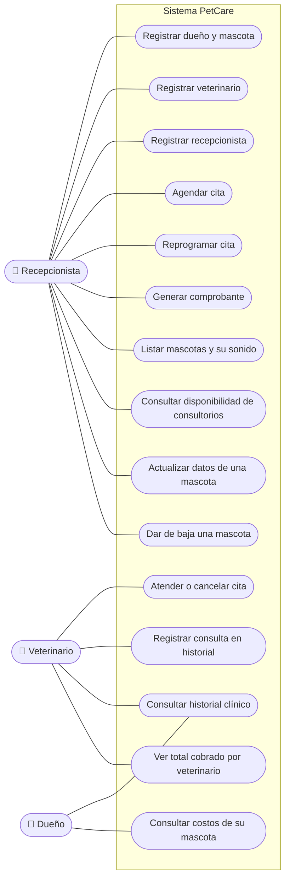

# Diagrama de casos de uso — PetCare

Muestra **quién** usa el sistema (actores) y **para qué** (casos de uso).
GitHub renderiza el bloque Mermaid automáticamente.

## Actores

| Actor | Rol en el sistema |
|---|---|
| Recepcionista | Da de alta personal, dueños y mascotas, agenda y reprograma citas, emite comprobantes y gestiona consultorios. |
| Veterinario | Atiende o cancela citas, registra consultas en el historial y revisa su total cobrado. |
| Dueño | Consulta la información de su mascota (historial y costos). |

## Diagrama



## Descripción breve de cada caso de uso

| Caso de uso | Actor principal | Qué hace |
|---|---|---|
| Registrar dueño y mascota | Recepcionista | Da de alta un dueño y su mascota (perro, gato o ave). |
| Registrar veterinario | Recepcionista | Añade un veterinario y lo asigna a la clínica. |
| Registrar recepcionista | Recepcionista | Da de alta personal de mostrador con su turno. |
| Agendar cita | Recepcionista | Programa una cita entre mascota, veterinario y consultorio en una fecha. |
| Reprogramar cita | Recepcionista | Cambia la fecha u hora de una cita ya programada, validando que no choque. |
| Atender o cancelar cita | Veterinario | Marca la cita como atendida o la cancela, respetando las reglas de negocio. |
| Registrar consulta en historial | Veterinario | Anota en el historial de la mascota lo realizado en la atención. |
| Generar comprobante | Recepcionista | Emite el comprobante con el total de una cita atendida. |
| Consultar historial clínico | Veterinario / Dueño | Revisa las consultas registradas de una mascota. |
| Ver total cobrado por veterinario | Veterinario | Muestra cuánto ha cobrado un veterinario. |
| Consultar costos de su mascota | Dueño | Muestra al dueño lo cobrado por los servicios de su mascota. |
| Listar mascotas y su sonido | Recepcionista | Recorre las mascotas llamando a `hacerSonido()` (demostración de polimorfismo). |
| Consultar disponibilidad de consultorios | Recepcionista | Verifica qué consultorios están libres antes de agendar. |
| Actualizar datos de una mascota | Recepcionista | Corrige peso o edad respetando las validaciones de negocio. |
| Dar de baja una mascota | Recepcionista | Elimina la mascota del sistema junto con su historial. |
```
