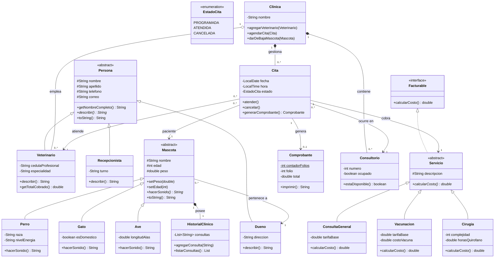

# Diagrama de clases — PetCare

Diagrama de clases del sistema de la clínica veterinaria PetCare.
GitHub renderiza este bloque Mermaid automáticamente al abrir el archivo.

## Leyenda de relaciones

| Notación | Significado | Ejemplo en el diagrama |
|---|---|---|
| Triángulo hueco (línea sólida) | Herencia ("es un") | `Perro` hereda de `Mascota` |
| Triángulo hueco (línea punteada) | Realización de interfaz | `Servicio` implementa `Facturable` |
| Rombo relleno | Composición (la parte muere con el todo) | `Clinica` posee `Consultorio` |
| Rombo hueco | Agregación (la parte sobrevive al todo) | `Clinica` emplea `Veterinario` |
| Flecha simple | Asociación (uso entre objetos independientes) | `Cita` usa `Mascota` |

## Diagrama

